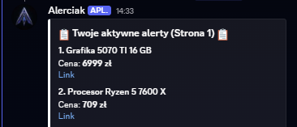

<p align="center">
  
</p>

# MakeAlert

This is an automatic Discord bot, that serves as a personal price tracker. It monitors product prices across different online stores and notifies the user via DM when a price drop or increase happens.

**Main features**:
- **Multi-store Scraping**: Collects prices from websites using Puppeteer with stealth plugins and human-like interactions.
- **Analytics**: Renders price history line charts (using Chart.js) directly inside Discord Embeds.
- **Automated Cron Jobs**: Background tracking executes daily at 12:00 PM, updating the database and pushing instant alerts upon detecting price changes.
&nbsp;

## 💡 Technologies


&nbsp;

## Installation

The project requires **Node.js 18+**

### 1. Install dependencies
Clone the repository and install the required npm packages:
```bash
npm install
```
The project relies on Puppeteer, so install the necessary browser binaries:
```bash
npx puppeteer browsers install chrome
```
*(On Linux you might also need system graphics libraries for canvas and chromium).*

### 2. Configure Your Environment
Create a `.env` file in the root directory:
```bash
DISCORD_TOKEN=discord_bot_token
OWNER_ID=your_discord_user_id
```

### 3. Run the project
To ensure the bot stays online and automatically restarts, use PM2:
```bash
npm install -g pm2
pm2 start index.js --name "MakeAlert"
pm2 save
pm2 startup
```

&nbsp;

## 🔧 Solutions for the problems I encountered

- **Bypassing Anti-Bot Systems**: Specific E-commerce sites deploy aggressive lazy-loading and anti-bot screens. To solve this, the scraper injects stealth scripts using `puppeteer-extra-plugin-stealth`, spoofs the `User-Agent`, and scrolls the page to trigger DOM rendering before attempting to extract prices.

&nbsp;

- **Expected terminal output**:
```text
[CRON] Starting price check...
Processing request for: https://www.example-store.pl/product/1232353452345235
Done.
Processing request for: https://www.example-store.pl/product/4561234555342345
Done.
[CRON] Done
```
 &nbsp;

- **Discord API & UI Constraints**: This project implements automated pagination and image buffering to bypass Discord's message limitations.

| Issue                     | Solution                       |
| ------------------------- | -----------------------------  |
|2000-character limit| The `/alert lista` command splits active alerts into multiple Embeds.|
|Fragile CSS Selectors| The scraper relies on `<meta>` tags and `JSON-LD` schemas instead of DOM/CSS paths when possible.|

&nbsp;

## 👋 Feel free to contact me
If you have any ideas on how to improve this project or want to collaborate, feel free to reach out.